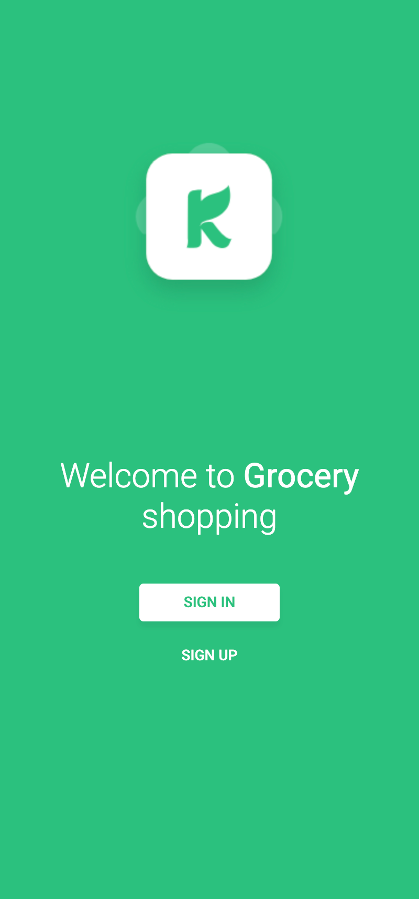
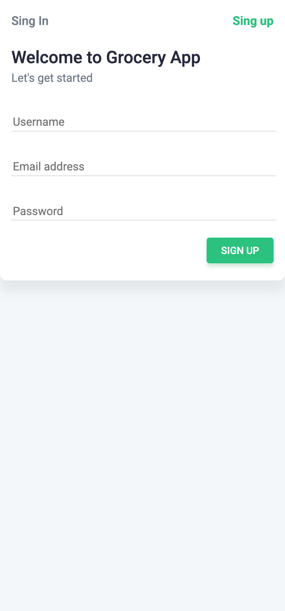

# Grocery Shopping Cart (Mobile)

<div align="center">


</div>

## Overview

A mobile-first React application demonstrating a grocery shopping cart flow with authentication screens. Built with Create React App, React Router, Material-UI, and Sass to showcase a clean, component-driven UI for e-commerce interactions on mobile devices.

## Key Features

- Welcome screen with branded logo and navigation options
- Sign up and sign in authentication flows
- Reusable UI components (Button, Input, Titles)
- Responsive mobile-first design with Sass styling
- React Router navigation between screens

## Tech Stack

React 16.13.1, Create React App 5, React Router 5, Material-UI 4, Sass 1.77, Node.js 18+

## Architecture

Create React App setup with class-based components, React Router for navigation, and a component-driven architecture with reusable UI elements. Styling handled through modular Sass files for each component.

## Performance & Accessibility

Mobile-optimized responsive design with modular component structure. Uses React Router for client-side routing and Material-UI components for consistent UI patterns.

## Prerequisites

- Node.js: `18.17.0` or higher
- npm: `9.0.0` or higher

## Installation

```bash
git clone https://github.com/maxgalchenko/grocery-shopping-cart--mobile.git
cd grocery-shopping-cart--mobile
npm install
```

## Quick Start

```bash
npm start
```

Open http://localhost:3000

## Available Scripts

- `npm start` – Start development server with legacy OpenSSL provider
- `npm run build` – Build production bundle with legacy OpenSSL provider
- `npm test` – Run test suite
- `npm run eject` – Eject from Create React App (irreversible)

## Screenshots




---

<div align="center">

Built with ❤️ by [Maksym Galchenko](https://github.com/maxgalchenko)

[](https://www.linkedin.com/in/galchenko-max/)
[](https://portfolio-green-six-29.vercel.app/)
[](mailto:galchenko.maksym@gmail.com)


</div>
